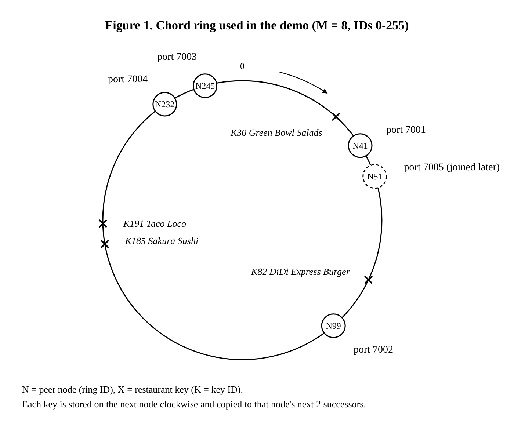

# DiDi Milestone 3 Report: P2P Overlay
## 1. Overlay topology

The overlay is a Chord-style ring: peers sit on a circle of 256 IDs, and each restaurant record lives on the first peer clockwise from its key.

- **Resource.** The shared resource is a restaurant record: the restaurant's name, the host and port of its order service, and its menu.
- **Peer IDs.** A peer's ID is `SHA-1("127.0.0.1:<port>") mod 256`. The demo runs five peers on one computer, on ports 7001 to 7005, connected by TCP.
- **Keys.** A restaurant's key is the SHA-1 of its name in lowercase, mod 256, so lookups ignore upper and lower case.
- **Ownership.** A peer owns every key in the range (predecessor ID, own ID\]. A key past the highest peer ID wraps around to the lowest one.
- **Links.** Each peer links to its predecessor, its next 2 successors, and 8 fingers. Finger *i* points to the owner of `id + 2^i`, so the fingers reach 1, 2, 4, up to 128 IDs ahead. The fingers are shortcuts across the ring.

| Peer (port) | 7001 | 7005 | 7002 | 7004 | 7003 |
| --- | --- | --- | --- | --- | --- |
| Ring ID | 41 | 51 | 99 | 232 | 245 |

| Restaurant | Green Bowl Salads | DiDi Express Burger | Sakura Sushi | Taco Loco |
| --- | --- | --- | --- | --- |
| Key | 30 | 82 | 185 | 191 |
| Owner (peers 7001-7004) | 7001 | 7002 | 7004 | 7004 |


## 2. Peer responsibilities

Every peer is equal: each one stores records, routes requests, and keeps the ring connected. There is no central server.

| Responsibility | What the peer does |
| --- | --- |
| Store records | Keeps the records whose keys it owns, in memory. |
| Hold replicas | Keeps copies of its predecessors' records, so the ring survives a crash. The owner sends each record to its 2 successors. |
| Route lookups | Answers `FIND_SUCCESSOR` if it knows the owner, or forwards it to the closest finger before the key. Every hop is logged. |
| Serve records | Answers `GET` and `PUT` for records it holds. |
| Keep the ring healthy | Every second, runs `stabilize`, `check_predecessor`, `fix_fingers`, and `replicate_primary` |
| Handle joins and leaves | Hands keys to a joining peer (`TRANSFER_KEYS`) and relinks itself when a neighbor leaves (`SET_PRED`, `SET_SUCC`). |
| Accept user commands | `PUBLISH`, `LOOKUP`, `STATUS`, and `LEAVE` from the `peer.py` command-line tool, through any peer. |

Peers talk over TCP, one JSON request and one JSON reply per connection. Each message is JSON text, a newline, encoded as UTF-8. Each peer handles every connection on its own thread, plus one maintenance thread.

## 3. Join and leave protocol

A peer joins through any running peer and leaves by handing its records to its successor; a stabilization step every second repairs the remaining links.

### 3.1 Join

Start a peer with `python peer.py start --port 7005 --join 7002`. The first peer has no `--join` and creates the ring.

1. The new peer sends `FIND_SUCCESSOR(own ID)` to the bootstrap peer. The reply names its successor.
2. It asks the successor for its predecessor (`GET_STATE`), then pulls the records in its new range with `TRANSFER_KEYS`.
3. It sends `NOTIFY` to the successor, which sets the new peer as its predecessor.
4. On the next `stabilize`, the old predecessor sees the new peer between itself and its successor and switches to it.


### 3.2 Stabilization

Every second, each peer runs four steps:

1. `stabilize`: ask the successor for its predecessor and successor list; move to a closer successor if one has joined, then `NOTIFY` it.
2. `check_predecessor`: `PING` the predecessor and clear it if it does not answer.
3. `fix_fingers`: look up the owner of each of the 8 finger targets.
4. `replicate_primary`: push the peer's own records to its 2 successors.

### 3.3 Leave

`python peer.py leave --port 7003` sends `LEAVE` to the peer.

1. It sends all its records to its successor (`BULK_PUT`).
2. It tells the successor its new predecessor (`SET_PRED`).
3. It tells its predecessor its new successor (`SET_SUCC`), then exits.


## 4. Lookup algorithm

A lookup can enter at any peer and is routed recursively through finger tables to the key's owner.

1. The entry peer hashes the restaurant name to a key, for example DiDi Express Burger to key 82.
2. If the key is in (own ID, successor ID\], the successor owns it, and routing stops.
3. Otherwise, the peer forwards `FIND_SUCCESSOR` to its closest finger that comes before the key, and that peer repeats step 2. Each hop adds itself to the `path` field and logs the request.
4. The last hop returns the owner's successor list: the owner first, then its replica.
5. The entry peer sends `GET` to the owner. If the owner does not answer, it tries the next peer in the list.

```
find_successor(key):
    if key in (my_id, successor.id]:
        return successor
    next = closest finger in (my_id, key), else successor
    return next.find_successor(key)      # forwarded over TCP
```

Publishing uses the same routing: `python peer.py publish --via 7001 "DiDi Express Burger" '<JSON>'` finds the owner and sends it `PUT`.

## 5. Failure behavior when a peer disappears

When a peer crashes, its records stay available because 2 other peers hold copies, and the ring repairs itself within a few seconds.

- **Replication.** When the owner receives a `PUT`, it copies the record to its 2 successors with `BULK_PUT`. Every second it pushes its records again, so a new successor also gets a copy.
- **Detection.** A crashed peer sends nothing. Any request to it fails after its timeout (2 seconds, or 4 for routed requests). The caller then removes the peer from its successor list and finger table. The crashed peer's successor also notices when its `PING` from `check_predecessor` fails.
- **Serving during repair.** A lookup that still names the crashed peer as owner tries the next peer in the owner's successor list, which holds a replica.
- **Recovery.** The successor clears its predecessor and takes over the crashed peer's key range. It already holds the replica copies, so no data has to move. The next `stabilize` and `NOTIFY` rounds relink the ring.

In the demo, the owner of DiDi Express Burger (7002) is killed without warning:

```
[PEER 7001 id=41] Owner/replica 7002 unreachable; trying next replica
[PEER 7001 id=41] Resource 'DiDi Express Burger' found on peer 7004 (replica)
[PEER 7001 id=41] Peer 7002 unreachable; removed from routing table
[PEER 7004 id=232] Predecessor 7002 failed; I now own its key range (served from replicas)
[PEER 7004 id=232] Predecessor is now peer 7005
```

About 5 seconds later, the same lookup finds the record on 7004 as the owner, without `(replica)`. A peer stopped with Ctrl+C behaves the same way, because it exits without sending `LEAVE` messages.

A record is lost only if its owner and both successors fail before the ring repairs. Records are kept in memory, so stopping every peer clears the ring.

## 6. Diagram of the P2P network

The diagram shows the five peers of the demo on the ring, the successor links between them, and the four restaurant keys.



The arrow at the top shows the direction of the ring, which is clockwise. Each restaurant is stored on the first node you hit going clockwise from its key, so DiDi Express Burger (K82) is on N99 (port 7002), and Sakura Sushi and Taco Loco are both on N232 (port 7004). Copies of each record are on the owner's next 2 nodes. For example, DiDi Express Burger also has copies on N232 and N245.

Peer 7005 (N51) is drawn with a dashed outline because it joined partway through the demo. Before that, 7001 linked straight to 7002. We left the finger links out of the figure because there are 8 per peer and the figure got too cluttered with them.